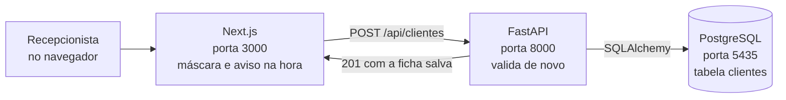
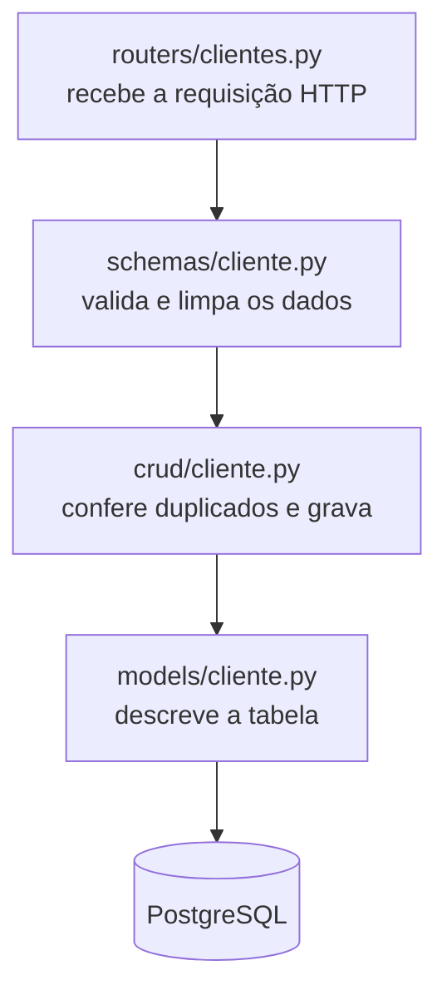

# Barbearia Dom Alfredo — Sistema de Gestão

Trabalho de faculdade desenvolvido por etapas. **Esta é a Etapa 1: o cadastro de clientes
completo** — front-end, back-end, banco de dados e testes automatizados.

O sistema simula o balcão de uma barbearia: a recepcionista cadastra o cliente perguntando
primeiro o telefone (que é a chave de busca da agenda) e o resto da ficha pode ser
completado depois.

**Next.js 16 + TypeScript + Tailwind 4** no front · **FastAPI + SQLAlchemy 2** no back ·
**PostgreSQL 16** no banco · **45 testes** no pytest

---

## Índice

1. [Rodando em 3 passos](#rodando-em-3-passos)
2. [O que já está pronto](#o-que-já-está-pronto)
3. [Como o sistema é montado](#como-o-sistema-é-montado)
4. [Tecnologias usadas](#tecnologias-usadas)
5. [O que precisa ter instalado](#o-que-precisa-ter-instalado)
6. [Instalação passo a passo](#instalação-passo-a-passo)
7. [Como rodar o projeto](#como-rodar-o-projeto)
8. [Como rodar os testes](#como-rodar-os-testes)
9. [Decisões que eu tomei](#decisões-que-eu-tomei)
10. [Estrutura das pastas](#estrutura-das-pastas)
11. [O banco de dados](#o-banco-de-dados)
12. [A API (endpoints)](#a-api-endpoints)
13. [Regras de validação](#regras-de-validação)
14. [Deu problema? (soluções)](#deu-problema-soluções)
15. [Próximas etapas](#próximas-etapas)

---

## Rodando em 3 passos

Precisa ter **Docker**, **Python 3.11+** e **Node 18+** na máquina. Se faltar algum,
veja [O que precisa ter instalado](#o-que-precisa-ter-instalado).

### 1. Instalar tudo (um comando só)

**Linux / macOS:**

```bash
bash scripts/instalar.sh
```

**Windows (PowerShell):**

```powershell
powershell -ExecutionPolicy Bypass -File scripts\instalar.ps1
```

> O `-ExecutionPolicy Bypass` é necessário porque o Windows bloqueia scripts `.ps1` por
> padrão. Ele vale só para essa execução, não muda a configuração da máquina.

O script sobe o PostgreSQL no Docker, instala as dependências do back e do front, cria os
arquivos `.env` e cadastra 3 clientes de exemplo pra tela não abrir vazia.

### 2. Ligar os dois servidores

Precisa de **dois terminais abertos ao mesmo tempo**.

| Terminal | Linux / macOS | Windows (PowerShell) |
|---|---|---|
| 1 — a API | `bash scripts/rodar-backend.sh` | `powershell -ExecutionPolicy Bypass -File scripts\rodar-backend.ps1` |
| 2 — o site | `bash scripts/rodar-frontend.sh` | `powershell -ExecutionPolicy Bypass -File scripts\rodar-frontend.ps1` |

### 3. Abrir no navegador

**http://localhost:3000**

Se algo não subir, a seção [Deu problema?](#deu-problema-soluções) tem as falhas mais comuns.

---

## O que já está pronto

| Camada | Entrega |
|---|---|
| **Front-end** | Tela de cadastro, listagem com busca e paginação, edição e exclusão de clientes |
| **Back-end** | API REST com as 6 rotas do CRUD, validação de CPF/telefone e tratamento de erros |
| **Banco** | Tabela `clientes` criada pelo SQLAlchemy, com índices e campos únicos |
| **Testes** | 45 testes no pytest cobrindo as validações e todas as rotas da API |

---

## Como o sistema é montado

São três programas separados conversando entre si:



Dentro do back-end, cada arquivo tem uma responsabilidade só. Uma requisição de cadastro
passa por esta fila:



Separei assim por dois motivos: dá pra testar o `crud` sem subir a API, e nas próximas
etapas é só repetir esses quatro arquivos para Barbeiros, Serviços e Agendamentos, sem
mexer no que já funciona.

---

## Tecnologias usadas

**Front-end**
- Next.js 16 (App Router)
- React 19
- TypeScript
- Tailwind CSS 4

**Back-end**
- Python 3.11+ (desenvolvido no 3.14)
- FastAPI — framework da API
- SQLAlchemy 2 — ORM que cria as tabelas e faz as consultas
- Pydantic 2 — validação dos dados
- psycopg 3 — driver do PostgreSQL
- pytest — testes automatizados

**Banco de dados**
- PostgreSQL 16 (rodando em Docker)

Todas as versões estão travadas no `backend/requirements.txt` e no
`frontend/package-lock.json`, então a instalação sai igual em qualquer máquina.

---

## O que precisa ter instalado

| Programa | Versão mínima | Como conferir |
|---|---|---|
| **Python** | 3.11 | `python3 --version` |
| **Node.js** | 18 (recomendado 20+) | `node --version` |
| **Docker** + Docker Compose | qualquer versão recente | `docker --version` |

> **Não quer usar Docker?** Dá pra usar um PostgreSQL instalado direto na máquina —
> veja a [Opção B](#opção-b--postgresql-instalado-na-máquina) logo abaixo.

---

## Instalação passo a passo

Só precisa disso se você não quiser usar o `scripts/instalar.sh` do
[Rodando em 3 passos](#rodando-em-3-passos).

### 1. Subir o banco de dados

#### Opção A — Docker (recomendado)

```bash
docker compose up -d
```

Isso sobe um PostgreSQL 16 com:

| Item | Valor |
|---|---|
| Usuário | `barbearia` |
| Senha | `barbearia` |
| Banco | `barbearia` |
| Banco de teste | `barbearia_teste` (criado automaticamente) |
| Porta | **5435** |

> **Por que a porta 5435 e não a 5432?** Porque muita gente já tem um PostgreSQL
> instalado usando a 5432, e aí o container não sobe. A 5435 evita essa briga.
> Se quiser mudar, é só editar o `docker-compose.yml` e o `backend/.env`.

Para conferir se subiu:

```bash
docker compose ps
```

#### Opção B — PostgreSQL instalado na máquina

Crie o usuário e os dois bancos:

```bash
sudo -u postgres psql
```

```sql
CREATE USER barbearia WITH PASSWORD 'barbearia';
CREATE DATABASE barbearia OWNER barbearia;
CREATE DATABASE barbearia_teste OWNER barbearia;
\q
```

Depois, no arquivo `backend/.env`, troque a porta **5435** por **5432**.

### 2. Instalar o back-end

```bash
cd backend

# cria o ambiente virtual do Python
python3 -m venv .venv

# ativa o ambiente virtual
source .venv/bin/activate          # Linux / macOS
# .venv\Scripts\activate           # Windows (PowerShell)

# instala as dependências
pip install -r requirements.txt

# cria o arquivo de configuração
cp .env.example .env               # Linux / macOS
# copy .env.example .env           # Windows
```

Se quiser começar com alguns clientes já cadastrados:

```bash
python popular_banco.py
```

### 3. Instalar o front-end

```bash
cd ../frontend

npm install

cp .env.local.example .env.local      # Linux / macOS
# copy .env.local.example .env.local  # Windows
```

---

## Como rodar o projeto

São **dois terminais** rodando ao mesmo tempo (mais o Docker do banco em segundo plano).

**Terminal 1 — a API:**

```bash
cd backend
source .venv/bin/activate     # no Windows: .venv\Scripts\activate
uvicorn app.main:app --reload
```

**Terminal 2 — o site:**

```bash
cd frontend
npm run dev
```

### Endereços

| O quê | Endereço |
|---|---|
| **O sistema (é aqui que se usa)** | http://localhost:3000 |
| Cadastro de cliente | http://localhost:3000/clientes/novo |
| API | http://localhost:8000 |
| **Documentação da API (Swagger)** | http://localhost:8000/docs |

> O Swagger em `/docs` é gerado sozinho pelo FastAPI: dá pra testar todas as rotas
> por ali, sem precisar do front.

---

## Como rodar os testes

```bash
cd backend
source .venv/bin/activate     # no Windows: .venv\Scripts\activate
pytest
```

Ou pelo atalho: `bash scripts/rodar-testes.sh` (Linux/macOS) ou
`powershell -ExecutionPolicy Bypass -File scripts\rodar-testes.ps1` (Windows).

Saída esperada:

```
tests/test_cadastro_cliente.py ..........................       [ 57%]
tests/test_validadores.py ...................                   [100%]

======================== 45 passed in 1.02s =========================
```

Para ver o nome de cada teste, `pytest -v`.

### O que os 45 testes cobrem

| Arquivo | Testes | O que verifica |
|---|---|---|
| `test_validadores.py` | 19 | Os dígitos verificadores do CPF, os DDDs que existem, o nono dígito do celular e as máscaras |
| `test_cadastro_cliente.py` | 26 | As 6 rotas da API, os erros de validação (422), os cadastros duplicados (409) e o cliente inexistente (404) |

Alguns casos que eu fiz questão de cobrir, porque são os que costumam passar batido:

- CPF `111.111.111-11` tem que ser **recusado** (ele passa na conta dos dígitos, então
  precisa de uma regra à parte).
- Dois clientes **sem e-mail** podem coexistir, mesmo com a coluna sendo única.
- Ao **editar**, o cliente não pode dar conflito com o próprio telefone.
- A busca por telefone tem que funcionar **com e sem máscara**.

Os testes usam o banco `barbearia_teste`, separado do banco de verdade — nada do que
está cadastrado é apagado. Se esse banco não existir, os testes rodam sozinhos em
SQLite na memória, então **o pytest funciona mesmo sem o Docker estar rodando**.

---

## Decisões que eu tomei

As escolhas do projeto que não são óbvias olhando só o código:

**Telefone e CPF são guardados só com números.**
A máscara é coisa de tela. Guardando `11990001234` no banco, a busca funciona igual se a
pessoa digitar com ou sem parênteses, e nunca vai existir o mesmo cliente cadastrado de
duas formas diferentes. A API devolve os dois formatos: `telefone` e `telefone_formatado`.

**A validação roda duas vezes, de propósito.**
No navegador para avisar na hora enquanto a pessoa digita, e de novo no servidor porque
validação de front qualquer um burla abrindo o console. A regra do CPF está escrita nos
dois lados (`lib/mascaras.ts` e `core/validadores.py`) com o mesmo cálculo.

**O erro 422 volta com o nome do campo.**
O FastAPI devolve um formato bem detalhado por padrão; eu simplifiquei em `main.py` para
`{campo, mensagem}`, e aí o front consegue pintar de vermelho exatamente o campo errado
em vez de mostrar um alerta genérico.

**O `crud` é separado dos `routers`.**
O router só cuida de HTTP (status, 404, 409) e o crud só cuida de banco. Isso deixa
testar as consultas sem subir a API.

**Os testes caem para SQLite se o Postgres não estiver de pé.**
Assim quem for corrigir o trabalho consegue rodar o `pytest` mesmo sem abrir o Docker.
Quando o banco de teste existe, os testes rodam nele — que é o cenário de verdade.

**O menu lateral só mostra o que funciona.**
Nada de item desabilitado como prévia das próximas etapas: botão que não faz nada só
engana quem está usando. Cada item entra quando a funcionalidade dele ficar pronta.

---

## Estrutura das pastas

```
projeto-faculdade/
├── README.md
├── docker-compose.yml           # sobe o PostgreSQL
├── scripts/                     # atalhos pra instalar e rodar (.sh e .ps1)
│
├── backend/
│   ├── requirements.txt         # dependências do Python
│   ├── .env.example             # modelo das configurações
│   ├── pytest.ini
│   ├── popular_banco.py         # cadastra clientes de exemplo
│   ├── app/
│   │   ├── main.py              # onde a API começa (CORS, erros, rotas)
│   │   ├── core/
│   │   │   ├── config.py        # lê o .env
│   │   │   ├── database.py      # conexão com o PostgreSQL
│   │   │   ├── validadores.py   # regras de CPF e telefone
│   │   │   └── erros.py
│   │   ├── models/cliente.py    # a tabela do banco (SQLAlchemy)
│   │   ├── schemas/cliente.py   # o que entra e sai da API (Pydantic)
│   │   ├── crud/cliente.py      # as consultas no banco
│   │   └── routers/clientes.py  # as rotas HTTP
│   └── tests/                   # os testes do pytest
│
└── frontend/
    └── src/
        ├── app/
        │   ├── layout.tsx                    # moldura: menu lateral + área de trabalho
        │   ├── globals.css                   # a paleta da barbearia no Tailwind
        │   └── clientes/
        │       ├── page.tsx                  # lista de clientes
        │       ├── novo/page.tsx             # cadastro
        │       └── [id]/editar/page.tsx      # edição
        ├── components/
        │   ├── FormularioCliente.tsx         # o formulário (serve pra criar e editar)
        │   ├── FichaResumo.tsx               # o cartão que se preenche enquanto digita
        │   ├── MenuLateral.tsx
        │   ├── Topo.tsx / Secao.tsx / Campo.tsx / Botao.tsx
        └── lib/
            ├── api.ts                        # todas as chamadas ao FastAPI
            ├── mascaras.ts                   # máscaras e validações no navegador
            └── tipos.ts                      # os tipos do TypeScript
```

---

## O banco de dados

Tabela **`clientes`** (criada automaticamente pelo SQLAlchemy quando a API sobe):

| Coluna | Tipo | Regra |
|---|---|---|
| `id` | inteiro | chave primária, automático |
| `nome` | texto (120) | obrigatório, com índice |
| `apelido` | texto (60) | opcional |
| `telefone` | texto (11) | **obrigatório e único** — guardado só com números |
| `cpf` | texto (11) | **obrigatório e único** — guardado só com números |
| `email` | texto (120) | opcional, mas único quando preenchido |
| `data_nascimento` | data | opcional |
| `barbeiro_preferido` | texto (60) | padrão: "Sem preferência" |
| `origem` | texto (30) | Indicação / Passou na porta / Instagram / Google |
| `observacoes` | texto longo | opcional |
| `criado_em` | data e hora | preenchido pelo banco |
| `atualizado_em` | data e hora | preenchido quando a ficha é editada |

O e-mail é único, mas aceita vários registros em branco: no PostgreSQL a restrição de
único ignora valores nulos, então clientes sem e-mail não brigam entre si.

Para espiar o banco por dentro:

```bash
docker exec -it barbearia-postgres psql -U barbearia -d barbearia
```

```sql
\dt                      -- lista as tabelas
SELECT * FROM clientes;  -- mostra os cadastros
\q                       -- sai
```

---

## A API (endpoints)

Base: `http://localhost:8000`

| Método | Rota | O que faz |
|---|---|---|
| `POST` | `/api/clientes` | Cadastra um cliente novo |
| `GET` | `/api/clientes` | Lista os clientes (`?busca=`, `?pagina=`, `?tamanho=`) |
| `GET` | `/api/clientes/{id}` | Abre a ficha de um cliente |
| `GET` | `/api/clientes/telefone/{telefone}` | Busca pelo telefone (a chave do balcão) |
| `PUT` | `/api/clientes/{id}` | Edita a ficha (só os campos enviados) |
| `DELETE` | `/api/clientes/{id}` | Exclui o cadastro |

### Exemplo de cadastro

```bash
curl -X POST http://localhost:8000/api/clientes \
  -H "Content-Type: application/json" \
  -d '{
    "nome": "Pablo Miguel Dias",
    "telefone": "(11) 99000-1234",
    "cpf": "529.982.247-25",
    "email": "pablo@email.com",
    "barbeiro_preferido": "Seu Alfredo",
    "origem": "Indicação"
  }'
```

### Códigos de resposta

| Código | Quando acontece |
|---|---|
| `201` | Cliente cadastrado |
| `200` | Consulta ou edição deu certo |
| `204` | Cliente excluído |
| `404` | Não existe cliente com esse id/telefone |
| `409` | Telefone, CPF ou e-mail já cadastrado em outra ficha |
| `422` | Algum campo do formulário está inválido |

O erro `422` vem com o campo e o motivo, para o front conseguir marcar o campo certo:

```json
{
  "detail": "Confira os campos do formulário.",
  "erros": [{ "campo": "cpf", "mensagem": "CPF inválido — confira os números digitados" }]
}
```

---

## Regras de validação

| Campo | Regra |
|---|---|
| **Nome** | Obrigatório, mínimo 3 letras e precisa ter nome **e** sobrenome |
| **Telefone** | Obrigatório. 10 dígitos (fixo) ou 11 (celular). DDD tem que existir e celular começa com 9 |
| **CPF** | Obrigatório. Os dois dígitos verificadores são conferidos (o mesmo cálculo da Receita). CPFs como `111.111.111-11` são recusados |
| **E-mail** | Opcional, mas se preencher tem que ser um e-mail válido |
| **Data de nascimento** | Opcional, não pode ser no futuro nem ter mais de 120 anos |
| **Origem** | Só aceita as 4 opções dos botões da tela |

---

## Deu problema? (soluções)

**"Não consegui falar com a API. Ela está rodando na porta 8000?"**
O front está no ar, mas a API não. Abra o terminal do back-end e rode `uvicorn app.main:app --reload`.

**A API não sobe e mostra erro de conexão com o banco**
O PostgreSQL não está de pé. Rode `docker compose up -d` e tente de novo.
Confira também se a porta do `backend/.env` bate com a do `docker-compose.yml`.

**`port is already allocated` ao subir o Docker**
Já tem outra coisa usando aquela porta na sua máquina. Troque a porta no
`docker-compose.yml` (ex: `"5436:5432"`) e ajuste o `backend/.env` para a mesma porta.

**`ModuleNotFoundError` ao rodar o pytest ou o uvicorn**
O ambiente virtual não está ativo. Rode `source .venv/bin/activate` (ou
`.venv\Scripts\activate` no Windows) antes.

**A porta 3000 já está em uso**
Rode o front em outra porta: `npm run dev -- -p 3001`. Nesse caso ajuste também o
`CORS_ORIGINS` do `backend/.env`, senão o navegador bloqueia as chamadas.

**No Windows, "execução de scripts foi desabilitada neste sistema"**
É o bloqueio padrão do PowerShell. Use `powershell -ExecutionPolicy Bypass -File <script>`,
como está nos comandos acima.

**Cadastrei um cliente e ele não aparece na lista**
A busca pode estar preenchida — limpe o campo de busca. Se continuar, confira no banco
com `docker exec -it barbearia-postgres psql -U barbearia -d barbearia -c "select * from clientes;"`.

**Quero apagar tudo e começar do zero**

```bash
docker compose down -v   # o -v apaga também os dados do banco
docker compose up -d
cd backend && python popular_banco.py
```

---

## Próximas etapas

- [x] **Etapa 1 — Cadastro de clientes** (esta entrega)
- [ ] Etapa 2 — Cadastro de barbeiros e serviços
- [ ] Etapa 3 — Agenda e agendamentos
- [ ] Etapa 4 — Caixa e relatórios
- [ ] Etapa 5 — Login e controle de acesso

Conforme cada etapa ficar pronta, o item correspondente aparece no menu lateral. A
estrutura do back-end (`models` / `schemas` / `crud` / `routers`) foi montada pensando
nisso: cada etapa nova é um conjunto novo desses quatro arquivos, sem mexer no que já funciona.
