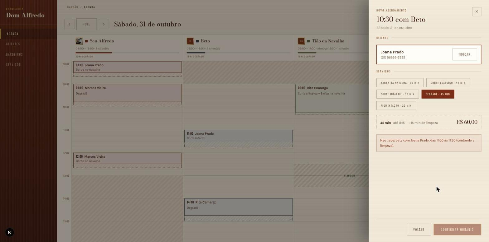
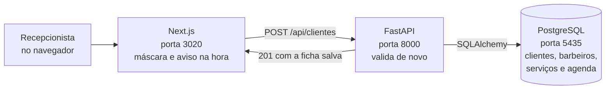
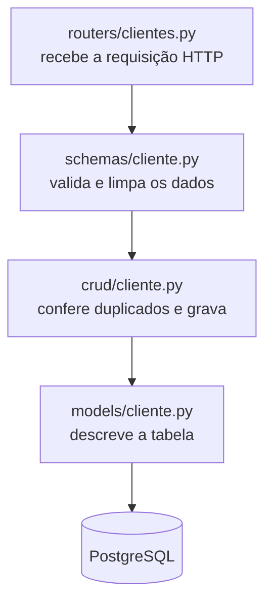

# Barbearia Dom Alfredo — Sistema de Gestão

Trabalho de faculdade desenvolvido por etapas. **Esta entrega é a Etapa 3: os serviços e o
agendamento**, somando com a Etapa 1 (cadastro de clientes) e a Etapa 2 (cadastro de
barbeiros) — todas completas com front-end, back-end, banco de dados e testes automatizados.

O sistema simula o balcão de uma barbearia: a recepcionista cadastra o cliente perguntando
primeiro o telefone (que é a chave de busca da agenda) e o resto da ficha pode ser
completado depois.

**Next.js 16 + TypeScript + Tailwind 4** no front · **FastAPI + SQLAlchemy 2** no back ·
**PostgreSQL 16** no banco · **127 testes** no pytest

---

## As telas

**Lista de clientes** — busca por nome, telefone ou CPF, com paginação:


**Cadastro de cliente** — a ficha da direita vai se preenchendo enquanto se digita:


**Validação** — o CPF é conferido pelos dígitos verificadores, então `111.111.111-11`
não passa:


**Equipe de barbeiros** — com a foto, a cor de cada um na agenda e o horário da semana
(quando um dia foge do padrão, ele aparece embaixo):


**Cadastro de barbeiro** — cada dia tem o próprio horário, e o cartão da direita mostra como
o cliente vai ver o barbeiro:


**Agenda do dia** — uma coluna por barbeiro, com o almoço e a ocupação no cabeçalho. Passando o
mouse num espaço vazio aparece o horário (aqui, 09:30 no Beto), e o calendário da lateral mostra
o quanto cada dia do mês está cheio:


**Marcar pela própria agenda** — clicando no horário, a gaveta abre ali mesmo. Ela já faz a
conta do tempo e avisa quando não cabe (aqui o degradê bateria com a Joana, contando a limpeza):



**Marcar horário** — a tela completa: o cliente pelo telefone, um ou mais serviços, o barbeiro
e só os horários livres. O resumo da direita fecha o total:


**Serviços** — o cardápio da casa, com a duração e o preço de cada um:


**Cadastro de serviço** — na direita, o serviço do jeito que aparece na hora de marcar:


---

## Índice

1. [Rodando em 3 passos](#rodando-em-3-passos)
2. [O que já está pronto](#o-que-já-está-pronto)
3. [Como o sistema é montado](#como-o-sistema-é-montado)
4. [Tecnologias usadas](#tecnologias-usadas)
5. [O que precisa ter instalado](#o-que-precisa-ter-instalado)
6. [Instalação passo a passo](#instalação-passo-a-passo)
7. [Como rodar o projeto](#como-rodar-o-projeto)
8. [Como rodar os testes](#como-rodar-os-testes)
9. [Decisões que eu tomei](#decisões-que-eu-tomei)
10. [Estrutura das pastas](#estrutura-das-pastas)
11. [O banco de dados](#o-banco-de-dados)
12. [A API (endpoints)](#a-api-endpoints)
13. [Regras de validação](#regras-de-validação)
14. [Deu problema? (soluções)](#deu-problema-soluções)

---

## Rodando em 3 passos

Precisa ter **Docker**, **Python 3.11+** e **Node 18+** na máquina. Se faltar algum,
veja [O que precisa ter instalado](#o-que-precisa-ter-instalado).

### 1. Instalar tudo (um comando só)

**Linux / macOS:**

```bash
bash scripts/instalar.sh
```

**Windows (PowerShell):**

```powershell
powershell -ExecutionPolicy Bypass -File scripts\instalar.ps1
```

> O `-ExecutionPolicy Bypass` é necessário porque o Windows bloqueia scripts `.ps1` por
> padrão. Ele vale só para essa execução, não muda a configuração da máquina.

O script sobe o PostgreSQL no Docker, instala as dependências do back e do front, cria os
arquivos `.env` e cadastra 3 clientes, 4 barbeiros e 5 serviços de exemplo pra tela não abrir vazia.

### 2. Ligar os dois servidores

Precisa de **dois terminais abertos ao mesmo tempo**.

| Terminal | Linux / macOS | Windows (PowerShell) |
|---|---|---|
| 1 — a API | `bash scripts/rodar-backend.sh` | `powershell -ExecutionPolicy Bypass -File scripts\rodar-backend.ps1` |
| 2 — o site | `bash scripts/rodar-frontend.sh` | `powershell -ExecutionPolicy Bypass -File scripts\rodar-frontend.ps1` |

### 3. Abrir no navegador

**http://localhost:3020**

> **Por que a 3020 e não a 3000 (o padrão do Next)?** Na minha máquina a 3000 e a 3010 já
> estavam ocupadas por outros projetos, então fixei a 3020 no `package.json`. Se quiser
> trocar, veja [A porta 3020 já está em uso](#a-porta-3020-já-está-em-uso).

Se algo não subir, a seção [Deu problema?](#deu-problema-soluções) tem as falhas mais comuns.

---

## O que já está pronto

| Camada | Entrega |
|---|---|
| **Front-end** | Clientes, barbeiros e serviços: cadastro, listagem com busca, edição e exclusão. Agenda do dia, marcar, remarcar, concluir, falta e cancelamento |
| **Back-end** | API REST com clientes (6 rotas), barbeiros (8 rotas, com a foto), serviços (5 rotas) e agendamentos (7 rotas), validações e tratamento de erros |
| **Banco** | Tabelas `clientes`, `barbeiros`, `horarios_barbeiro`, `servicos`, `agendamentos` e `agendamento_servicos` criadas pelo SQLAlchemy |
| **Testes** | 127 testes no pytest cobrindo as validações, todas as rotas da API e as regras da agenda |

### Etapa 3 — serviços e agendamento

- **Serviços:** o cardápio da casa, com nome, descrição, duração (de 5 em 5 minutos) e preço.
  A chave "No cardápio" tira o serviço da marcação sem apagar o histórico.
- **Agenda do dia:** uma coluna por barbeiro, com o horário de cada um. O que está fora do
  expediente aparece hachurado, a cauda tracejada de cada cliente é a limpeza da cadeira (o
  intervalo do barbeiro) e a linha vermelha é a hora atual. Na direita, o resumo do dia
  (agendados, concluídos, faltas, cancelados e o valor previsto).
- **Marcar:** a recepção busca o cliente pelo telefone, marca um ou mais serviços, escolhe o
  barbeiro e o horário. Só aparecem os dias em que o barbeiro trabalha e os horários livres.
- **Marcar direto da agenda:** passando o mouse numa coluna aparece o horário (de 15 em 15
  minutos), só onde dá pra marcar. Clicando, abre uma gaveta lateral com o cliente e os
  serviços, que já avisa se o atendimento cabe ou bate com outro cliente. Ao confirmar, o
  bloco novo aparece na grade e um aviso confirma embaixo, sem sair da tela.
- **Arrastar pra remarcar:** dá pra pegar o cliente e soltar em outro horário ou na coluna de
  outro barbeiro. Enquanto arrasta, uma prévia mostra o novo horário e diz se cabe ali; soltando
  num lugar que não cabe, nada muda. A API confere tudo de novo antes de salvar.
- **Ocupação:** o cabeçalho de cada barbeiro mostra o expediente, o almoço, uma barra na cor
  dele e quanto do dia já está tomado ("45% ocupado"). O almoço sai da conta.
- **Almoço:** a ficha do barbeiro ganhou o horário de almoço (opcional) e a duração (30 min a
  1h30), valendo pra semana toda. Na agenda ele aparece como uma faixa listrada em oliva, e a
  API não deixa marcar cliente nesse intervalo. Num dia que acaba antes do fim do almoço (o
  sábado curto do Seu Alfredo), o almoço não conta.
- **Calendário:** na lateral, um calendário do mês pra pular direto pra qualquer dia. A barrinha
  embaixo de cada número mostra o quanto aquele dia está cheio, e dia em que ninguém da equipe
  trabalha fica apagado.
- **Movimento:** os clientes entram na grade um depois do outro, sobem um pouco quando o mouse
  passa, a troca de dia faz um fade e a linha da hora atual tem um ponto pulsando. Quem deixa
  o computador em "reduzir movimento" vê tudo parado.
- **Depois de marcar:** clicando no cliente na agenda dá pra remarcar, cancelar e, quando o
  horário chega, marcar como concluído ou falta.
- **Ligação com as etapas anteriores:** cliente, barbeiro ou serviço que tem agendamento não
  pode mais ser excluído (a tela explica o que fazer no lugar), e barbeiro desligado não aparece
  pra marcar.

O que eu **deixei de fora de propósito**, mesmo estando no protótipo: bloqueio de horário,
encaixe, "sem preferência" de barbeiro e o caixa. Ainda não existem no sistema, e a limpeza
por serviço repetiria o intervalo que o barbeiro já tem. Pela mesma regra do menu, só entra na
tela o que funciona.

### Etapa 2 — o que o cadastro de barbeiro tem

- **Foto de perfil:** clica na moldura dourada e escolhe a foto. O navegador recorta no
  quadrado e diminui antes de enviar, e a foto fica guardada no próprio banco.
- **Dados pessoais:** nome, nome na cadeira (o nome que o cliente vê), telefone, e-mail, CPF
  e "na casa desde" (mês e ano).
- **Ofício:** especialidades, comissão, intervalo entre atendimentos e a cor dele na agenda.
- **Dias e horários:** cada dia da semana tem o próprio horário (o sábado pode fechar mais
  cedo); dia desmarcado é folga.
- **Como o cliente vê:** o cartão da direita mostra, enquanto se digita, como o barbeiro vai
  aparecer para o cliente.
- **Disponível para agendamento:** chave para desligar em férias ou afastamento, sem apagar
  o cadastro.
- **Ligação com a Etapa 1:** o campo "barbeiro preferido" da ficha do cliente agora lista a
  equipe cadastrada (só quem está disponível), em vez de uma lista fixa no código.

### O que mudou na tela do cliente durante a Etapa 2

- **As fontes voltaram a aparecer.** Os títulos estavam saindo com a fonte do
  sistema em vez da Bodoni. O motivo: o `next/font` declarava as fontes no `<body>`, mas o
  tema do Tailwind é montado no `<html>`, um nível acima, onde elas ainda não existiam. Passei
  as fontes para o `<html>` no `layout.tsx`.
- **Acabamento:** acertei espaçamentos, a altura dos campos (45px) e a ficha da direita.

### Arrumação do código

Antes de fechar a etapa, tirei o que estava repetido entre cliente e barbeiro, pra próxima
etapa (serviços) já nascer em cima de peças prontas:

| Onde | O que era repetido | Virou |
|---|---|---|
| `schemas/` | as validações de nome, telefone, CPF e texto | `schemas/regras.py`, usado pelos dois |
| `crud/` | conferir duplicados, buscar e paginar | `crud/comum.py`, usado pelos dois |
| formulários | rodapé com Excluir/Cancelar/Salvar | `RodapeDoFormulario.tsx` |
| formulários | tela de "deu certo" | `Confirmacao.tsx` |
| formulários | botões de marcar e o select com setinha | `Opcao.tsx` e `Seletor` (em `Campo.tsx`) |
| formulários | dados, erros por campo e aviso do rodapé | `lib/useFormulario.ts` |
| formulários | ler o erro que a API devolve | `lerErroDoFormulario` (em `lib/api.ts`) |
| listas | anterior / próxima | `Paginacao.tsx` |

O formulário do barbeiro, que tinha passado de 700 linhas, foi dividido em partes com uma
responsabilidade cada: a foto (`EscolherFoto.tsx`), a tabela de horários (`JornadaSemanal.tsx`)
e as contas da semana (`lib/semana.ts`).

---

## Como o sistema é montado

São três programas separados conversando entre si:



Dentro do back-end, cada arquivo tem uma responsabilidade só. Uma requisição de cadastro
passa por esta fila:



Separei assim por dois motivos: dá pra testar o `crud` sem subir a API, e cada etapa nova
é só repetir esses quatro arquivos. O barbeiro (etapa 2) seguiu exatamente esse caminho, e o
que ficou igual nos dois foi pra `schemas/regras.py` e `crud/comum.py`. Na etapa 3 o serviço e
o agendamento também, e as regras da agenda ficaram todas juntas em `crud/agendamento.py`.

---

## Tecnologias usadas

**Front-end**
- Next.js 16 (App Router)
- React 19
- TypeScript
- Tailwind CSS 4

**Back-end**
- Python 3.11+ (desenvolvido no 3.14)
- FastAPI — framework da API
- SQLAlchemy 2 — ORM que cria as tabelas e faz as consultas
- Pydantic 2 — validação dos dados
- psycopg 3 — driver do PostgreSQL
- pytest — testes automatizados

**Banco de dados**
- PostgreSQL 16 (rodando em Docker)

Todas as versões estão travadas no `backend/requirements.txt` e no
`frontend/package-lock.json`, então a instalação sai igual em qualquer máquina.

---

## O que precisa ter instalado

| Programa | Versão mínima | Como conferir |
|---|---|---|
| **Python** | 3.11 | `python3 --version` |
| **Node.js** | 18 (recomendado 20+) | `node --version` |
| **Docker** + Docker Compose | qualquer versão recente | `docker --version` |

> **Não quer usar Docker?** Dá pra usar um PostgreSQL instalado direto na máquina —
> veja a [Opção B](#opção-b--postgresql-instalado-na-máquina) logo abaixo.

---

## Instalação passo a passo

Só precisa disso se você não quiser usar o `scripts/instalar.sh` do
[Rodando em 3 passos](#rodando-em-3-passos).

### 1. Subir o banco de dados

#### Opção A — Docker (recomendado)

```bash
docker compose up -d
```

Isso sobe um PostgreSQL 16 com:

| Item | Valor |
|---|---|
| Usuário | `barbearia` |
| Senha | `barbearia` |
| Banco | `barbearia` |
| Banco de teste | `barbearia_teste` (criado automaticamente) |
| Porta | **5435** |

> **Por que a porta 5435 e não a 5432?** Porque muita gente já tem um PostgreSQL
> instalado usando a 5432, e aí o container não sobe. A 5435 evita essa briga.
> Se quiser mudar, é só editar o `docker-compose.yml` e o `backend/.env`.

Para conferir se subiu:

```bash
docker compose ps
```

#### Opção B — PostgreSQL instalado na máquina

Crie o usuário e os dois bancos:

```bash
sudo -u postgres psql
```

```sql
CREATE USER barbearia WITH PASSWORD 'barbearia';
CREATE DATABASE barbearia OWNER barbearia;
CREATE DATABASE barbearia_teste OWNER barbearia;
\q
```

Depois, no arquivo `backend/.env`, troque a porta **5435** por **5432**.

### 2. Instalar o back-end

```bash
cd backend

# cria o ambiente virtual do Python
python3 -m venv .venv

# ativa o ambiente virtual
source .venv/bin/activate          # Linux / macOS
# .venv\Scripts\activate           # Windows (PowerShell)

# instala as dependências
pip install -r requirements.txt

# cria o arquivo de configuração
cp .env.example .env               # Linux / macOS
# copy .env.example .env           # Windows
```

Se quiser começar com alguns clientes, barbeiros e serviços já cadastrados:

```bash
python popular_banco.py
```

### 3. Instalar o front-end

```bash
cd ../frontend

npm install

cp .env.local.example .env.local      # Linux / macOS
# copy .env.local.example .env.local  # Windows
```

---

## Como rodar o projeto

São **dois terminais** rodando ao mesmo tempo (mais o Docker do banco em segundo plano).

**Terminal 1 — a API:**

```bash
cd backend
source .venv/bin/activate     # no Windows: .venv\Scripts\activate
uvicorn app.main:app --reload
```

**Terminal 2 — o site:**

```bash
cd frontend
npm run dev
```

### Endereços

| O quê | Endereço |
|---|---|
| **O sistema (é aqui que se usa)** | http://localhost:3020 |
| Cadastro de cliente | http://localhost:3020/clientes/novo |
| Equipe de barbeiros | http://localhost:3020/barbeiros |
| Cadastro de barbeiro | http://localhost:3020/barbeiros/novo |
| **Agenda do dia** | http://localhost:3020/agenda |
| Marcar horário | http://localhost:3020/agenda/novo |
| Serviços | http://localhost:3020/servicos |
| API | http://localhost:8000 |
| **Documentação da API (Swagger)** | http://localhost:8000/docs |

> O Swagger em `/docs` é gerado sozinho pelo FastAPI: dá pra testar todas as rotas
> por ali, sem precisar do front.

---

## Como rodar os testes

```bash
cd backend
source .venv/bin/activate     # no Windows: .venv\Scripts\activate
pytest
```

Ou pelo atalho: `bash scripts/rodar-testes.sh` (Linux/macOS) ou
`powershell -ExecutionPolicy Bypass -File scripts\rodar-testes.ps1` (Windows).

Saída esperada:

```
tests/test_agendamento.py ................................          [ 25%]
tests/test_cadastro_barbeiro.py .....................................  [ 54%]
tests/test_cadastro_cliente.py ..........................           [ 73%]
tests/test_cadastro_servico.py .............                        [ 84%]
tests/test_validadores.py ...................                      [100%]

======================== 127 passed in 18.57s ========================
```

Para ver o nome de cada teste, `pytest -v`.

### O que os 127 testes cobrem

| Arquivo | Testes | O que verifica |
|---|---|---|
| `test_validadores.py` | 19 | Os dígitos verificadores do CPF, os DDDs que existem, o nono dígito do celular e as máscaras |
| `test_cadastro_cliente.py` | 26 | As 6 rotas da API, os erros de validação (422), os cadastros duplicados (409) e o cliente inexistente (404) |
| `test_cadastro_barbeiro.py` | 37 | As 8 rotas de barbeiro, o horário de cada dia, as opções de ofício, os duplicados, se os horários somem junto com o barbeiro e o envio da foto (tipo e tamanho) |
| `test_cadastro_servico.py` | 13 | As 5 rotas de serviço, duração de 5 em 5, preço com centavos, nome repetido (mesmo mudando maiúscula) e o filtro do cardápio |
| `test_agendamento.py` | 32 | As 7 rotas da agenda: expediente, folga, almoço, horário que já passou, choque com a limpeza do barbeiro, cliente em duas cadeiras, remarcação, concluir/faltar/cancelar e a proibição de apagar o que tem agendamento |

Alguns casos que eu fiz questão de cobrir, porque são os que costumam passar batido:

- CPF `111.111.111-11` tem que ser **recusado** (ele passa na conta dos dígitos, então
  precisa de uma regra à parte).
- Dois clientes **sem e-mail** podem coexistir, mesmo com a coluna sendo única.
- Ao **editar**, o cliente não pode dar conflito com o próprio telefone.
- A busca por telefone tem que funcionar **com e sem máscara**.
- No barbeiro, **saída antes da entrada** é recusada e a mensagem diz em qual dia foi.
- Editar a semana de 5 dias para 1 tem que **apagar as 4 linhas** que sobraram no banco.
- Salvar a ficha do barbeiro **com os mesmos dias de novo** não pode dar conflito — esse
  teste pegou um erro de verdade: o SQLAlchemy tentava gravar a terça nova antes de apagar
  a velha (a correção está comentada em `crud/barbeiro.py`).
- Na agenda, um corte de 45 min às 9:05 cabe antes de um cliente das 10h (termina 9:50, mais
  10 de limpeza = 10:00), mas às 9:10 **já não cabe**.
- **Remarcar no mesmo horário** não pode bater com o próprio agendamento.
- O preço que fica no agendamento é **o do dia em que foi marcado**, mesmo se o serviço subir.
- A ocupação do calendário **não conta o cancelado** e diz que ninguém trabalha na segunda.

Os testes da agenda **travam o relógio** (com o `monkeypatch` do pytest) numa segunda-feira de
2029. Sem isso, "esse horário já passou" dependeria do dia em que o teste roda, e um teste
que passa hoje quebraria semana que vem.

Os testes usam o banco `barbearia_teste`, separado do banco de verdade — nada do que
está cadastrado é apagado. Se esse banco não existir, os testes rodam sozinhos em
SQLite na memória, então **o pytest funciona mesmo sem o Docker estar rodando**.

---

## Decisões que eu tomei

As escolhas do projeto que não são óbvias olhando só o código:

**Telefone e CPF são guardados só com números.**
A máscara é coisa de tela. Guardando `11990001234` no banco, a busca funciona igual se a
pessoa digitar com ou sem parênteses, e nunca vai existir o mesmo cliente cadastrado de
duas formas diferentes. A API devolve os dois formatos: `telefone` e `telefone_formatado`.

**A validação roda duas vezes, de propósito.**
No navegador para avisar na hora enquanto a pessoa digita, e de novo no servidor porque
validação de front qualquer um burla abrindo o console. A regra do CPF está escrita nos
dois lados (`lib/mascaras.ts` e `core/validadores.py`) com o mesmo cálculo.

**O erro 422 volta com o nome do campo.**
O FastAPI devolve um formato bem detalhado por padrão; eu simplifiquei em `main.py` para
`{campo, mensagem}`, e aí o front consegue pintar de vermelho exatamente o campo errado
em vez de mostrar um alerta genérico.

**O `crud` é separado dos `routers`.**
O router só cuida de HTTP (status, 404, 409) e o crud só cuida de banco. Isso deixa
testar as consultas sem subir a API.

**Os testes caem para SQLite se o Postgres não estiver de pé.**
Assim quem for corrigir o trabalho consegue rodar o `pytest` mesmo sem abrir o Docker.
Quando o banco de teste existe, os testes rodam nele — que é o cenário de verdade.

**Os horários do barbeiro ficam numa tabela própria (`horarios_barbeiro`).**
Cada dia pode ter um horário diferente, então uma linha por dia trabalhado. Pensei em guardar
tudo num campo JSON, mas na etapa da agenda vou precisar perguntar "quem trabalha quinta às
15h?", e com tabela isso é um `SELECT` simples. Dia sem linha é folga.

**Barbeiro não precisa ser apagado pra sair da agenda.**
A chave "Disponível para agendamento" desliga o barbeiro (férias, afastamento ou quem saiu da
casa) sem perder a ficha. Quando a agenda existir, os atendimentos antigos dele continuam
apontando pra um cadastro que existe.

**A foto do barbeiro fica guardada no banco, não numa pasta.**
Com pasta eu teria que configurar o caminho em cada máquina e lembrar de copiar a pasta junto
com o backup. No banco, o backup do Postgres já leva as fotos. Pra não pesar, o navegador
recorta e reduz a foto pra 480x480 antes de enviar (uns 60 KB), e a listagem não carrega os
bytes — só o endereço da foto, que é buscada à parte.

**O "barbeiro preferido" do cliente vem da equipe cadastrada.**
Na etapa 1 era uma lista fixa no código. Agora o select busca os barbeiros disponíveis na API.
Se o cliente tinha um barbeiro que saiu, o nome continua aparecendo na ficha dele, pra
preferência não mudar sem a recepção perceber.

**O preço e a duração ficam copiados no agendamento.**
Se o corte subir de R$ 55 pra R$ 60 amanhã, quem já marcou paga o combinado, e o caixa da
próxima etapa lê o valor direto do agendamento. O nome do serviço eu não copio: serviço que já
foi usado não pode ser apagado, só tirado do cardápio, então ele sempre existe.

**A limpeza da cadeira é do barbeiro, não do serviço.**
O protótipo tinha um tempo de limpeza em cada serviço, mas o barbeiro já tem o "intervalo" desde
a etapa 2. Ter os dois seria a mesma informação em dois lugares. A agenda soma o intervalo do
barbeiro depois de cada cliente na hora de conferir se um horário bate com outro.

**Quem diz se o horário está livre é a API.**
A tela de marcar pergunta pra API (`/api/agendamentos/horarios`) quais horários estão livres, em
vez de calcular sozinha. Assim a regra de choque fica escrita num lugar só, e se duas pessoas
tentarem o mesmo horário ao mesmo tempo, a segunda recebe o aviso na hora de confirmar.

**Agendamento não se apaga, se cancela.**
Não tem DELETE de agendamento: cancelar libera o horário e deixa registrado. Concluído e falta
só podem ser marcados depois que o horário chegou, e um agendamento fechado não muda mais.


---

## Estrutura das pastas

```
projeto-faculdade/
├── README.md
├── docker-compose.yml           # sobe o PostgreSQL
├── docs/imagens/                # as telas que aparecem neste README
├── scripts/                     # atalhos pra instalar e rodar (.sh e .ps1)
│
├── backend/
│   ├── requirements.txt         # dependências do Python
│   ├── .env.example             # modelo das configurações
│   ├── pytest.ini
│   ├── popular_banco.py         # cadastra clientes e barbeiros de exemplo
│   ├── app/
│   │   ├── main.py              # onde a API começa (CORS, erros, rotas)
│   │   ├── core/
│   │   │   ├── config.py        # lê o .env
│   │   │   ├── database.py      # conexão com o PostgreSQL
│   │   │   ├── validadores.py   # regras de CPF e telefone
│   │   │   └── erros.py
│   │   ├── models/              # as tabelas do banco (SQLAlchemy)
│   │   │   ├── cliente.py
│   │   │   ├── barbeiro.py      # barbeiros + horarios_barbeiro
│   │   │   ├── servico.py       # etapa 3
│   │   │   └── agendamento.py   # agendamentos + agendamento_servicos
│   │   ├── schemas/             # o que entra e sai da API (Pydantic)
│   │   │   ├── regras.py        # validações que cliente e barbeiro têm iguais
│   │   │   ├── cliente.py
│   │   │   ├── barbeiro.py
│   │   │   ├── servico.py
│   │   │   └── agendamento.py
│   │   ├── crud/                # as consultas no banco
│   │   │   ├── comum.py         # duplicados, busca e paginação dos dois
│   │   │   ├── cliente.py
│   │   │   ├── barbeiro.py
│   │   │   ├── servico.py
│   │   │   └── agendamento.py   # todas as regras da agenda
│   │   └── routers/             # as rotas HTTP
│   │       ├── clientes.py
│   │       ├── barbeiros.py
│   │       ├── servicos.py
│   │       └── agendamentos.py
│   └── tests/                   # os testes do pytest
│
└── frontend/
    └── src/
        ├── app/
        │   ├── layout.tsx                    # moldura: menu lateral + área de trabalho
        │   ├── globals.css                   # a paleta da barbearia no Tailwind
        │   ├── clientes/
        │   │   ├── page.tsx                  # lista de clientes
        │   │   ├── novo/page.tsx             # cadastro
        │   │   └── [id]/editar/page.tsx      # edição
        │   ├── barbeiros/
        │   │   ├── page.tsx                  # a equipe (filtro "na agenda / fora da agenda")
        │   │   ├── novo/page.tsx             # cadastro
        │   │   └── [id]/editar/page.tsx      # edição
        │   ├── servicos/                     # etapa 3: lista, novo e edição
        │   └── agenda/
        │       ├── page.tsx                  # a agenda do dia
        │       ├── novo/page.tsx             # marcar horário
        │       └── [id]/remarcar/page.tsx    # remarcar
        ├── components/
        │   ├── FormularioCliente.tsx         # o formulário do cliente (cria e edita)
        │   ├── FichaResumo.tsx               # o cartão que se preenche enquanto digita
        │   ├── FormularioBarbeiro.tsx        # o formulário do barbeiro (cria e edita)
        │   ├── EscolherFoto.tsx              # a moldura da foto de perfil
        │   ├── JornadaSemanal.tsx            # a tabela de dias e horários
        │   ├── FichaBarbeiro.tsx             # "como o cliente vê" + disponível para agendamento
        │   ├── Retrato.tsx                   # a foto na moldura (cartão e lista)
        │   ├── FormularioServico.tsx         # o formulário do serviço (cria e edita)
        │   ├── AgendaDoDia.tsx               # a grade da agenda, o fantasma do mouse e o detalhe
        │   ├── GavetaDeAgendamento.tsx       # marcar sem sair da agenda
        │   ├── CalendarioDaAgenda.tsx        # o calendário do mês com a ocupação de cada dia
        │   ├── BuscaDeCliente.tsx            # busca pelo telefone (gaveta e tela de marcar)
        │   ├── FormularioAgendamento.tsx     # marcar e remarcar
        │   ├── Chave.tsx                     # a chave liga/desliga (barbeiro e serviço)
        │   ├── RodapeDoFormulario.tsx / Confirmacao.tsx / Opcao.tsx / Paginacao.tsx
        │   ├── MenuLateral.tsx
        │   └── Topo.tsx / Secao.tsx / Campo.tsx / Botao.tsx
        └── lib/
            ├── api.ts                        # todas as chamadas ao FastAPI
            ├── mascaras.ts                   # máscaras e validações no navegador
            ├── useFormulario.ts              # dados, erros e aviso de um formulário
            ├── semana.ts                     # as contas da semana de trabalho
            ├── foto.ts                       # recorta e reduz a foto do barbeiro antes do envio
            ├── agenda.ts                     # contas de data, hora e dinheiro da agenda
            └── tipos.ts                      # os tipos do TypeScript
```

---

## O banco de dados

Tabela **`clientes`** (criada automaticamente pelo SQLAlchemy quando a API sobe):

| Coluna | Tipo | Regra |
|---|---|---|
| `id` | inteiro | chave primária, automático |
| `nome` | texto (120) | obrigatório, com índice |
| `apelido` | texto (60) | opcional |
| `telefone` | texto (11) | **obrigatório e único** — guardado só com números |
| `cpf` | texto (11) | **obrigatório e único** — guardado só com números |
| `email` | texto (120) | opcional, mas único quando preenchido |
| `data_nascimento` | data | opcional |
| `barbeiro_preferido` | texto (60) | padrão: "Sem preferência" |
| `origem` | texto (30) | Indicação / Passou na porta / Instagram / Google |
| `observacoes` | texto longo | opcional |
| `criado_em` | data e hora | preenchido pelo banco |
| `atualizado_em` | data e hora | preenchido quando a ficha é editada |

O e-mail é único, mas aceita vários registros em branco: no PostgreSQL a restrição de
único ignora valores nulos, então clientes sem e-mail não brigam entre si.

Tabela **`barbeiros`** (etapa 2):

| Coluna | Tipo | Regra |
|---|---|---|
| `id` | inteiro | chave primária, automático |
| `nome` | texto (120) | obrigatório, com índice |
| `apelido` | texto (60) | opcional — o "nome na cadeira", que é o que o cliente vê |
| `telefone` | texto (11) | **obrigatório e único** — só números |
| `cpf` | texto (11) | **obrigatório e único** — só números |
| `email` | texto (120) | opcional, mas único quando preenchido |
| `data_admissao` | data | "na casa desde": a tela pede mês e ano e grava o dia 1. Sem valor, a API usa hoje |
| `foto` | binário | a foto de perfil (JPEG já reduzido pelo navegador), opcional |
| `foto_tipo` | texto (30) | image/jpeg, image/png ou image/webp |
| `foto_atualizada_em` | data e hora | quando a foto mudou — também evita o navegador mostrar a foto velha |
| `especialidades` | JSON | lista com pelo menos uma das 6 opções da tela |
| `comissao` | inteiro | de 0 a 100 (%), padrão 40 |
| `intervalo` | inteiro | minutos entre atendimentos: 0 (nenhum), 5, 10 ou 15 |
| `cor_agenda` | texto (20) | terracota / oliva / latao / petroleo |
| `almoco` | hora | etapa 3, opcional: começo do almoço, de 5 em 5 minutos |
| `almoco_duracao` | inteiro | 30, 45, 60 ou 90 minutos (padrão 60) |
| `ativo` | sim/não | "disponível para agendamento", com índice |
| `observacoes` | texto longo | opcional |
| `criado_em` / `atualizado_em` | data e hora | preenchidos pelo banco |

Tabela **`horarios_barbeiro`** — uma linha por dia trabalhado:

| Coluna | Tipo | Regra |
|---|---|---|
| `id` | inteiro | chave primária |
| `barbeiro_id` | inteiro | chave estrangeira para `barbeiros` (apaga junto com o barbeiro) |
| `dia` | texto (3) | seg, ter, qua, qui, sex, sab ou dom |
| `entrada` / `saida` | hora | a saída tem que ser depois da entrada |

O par (`barbeiro_id`, `dia`) é único: o mesmo barbeiro não tem duas linhas pra terça.

Tabela **`servicos`** (etapa 3):

| Coluna | Tipo | Regra |
|---|---|---|
| `id` | inteiro | chave primária |
| `nome` | texto (60) | **obrigatório e único** (sem diferenciar maiúscula) |
| `descricao` | texto (120) | opcional |
| `duracao` | inteiro | minutos, de 5 a 240, de 5 em 5 |
| `preco` | decimal (8,2) | maior que zero, até R$ 1.000 — decimal e não float, porque é dinheiro |
| `ativo` | sim/não | "no cardápio" |
| `criado_em` / `atualizado_em` | data e hora | preenchidos pelo banco |

Tabela **`agendamentos`**:

| Coluna | Tipo | Regra |
|---|---|---|
| `id` | inteiro | chave primária |
| `cliente_id` | inteiro | chave estrangeira para `clientes` |
| `barbeiro_id` | inteiro | chave estrangeira para `barbeiros` (índice junto com a `data`) |
| `data` | data | o dia do atendimento |
| `inicio` / `fim` | hora | o fim já vem calculado: início + duração dos serviços |
| `situacao` | texto (10) | agendado, concluido, faltou ou cancelado |
| `criado_em` / `atualizado_em` | data e hora | preenchidos pelo banco |

Tabela **`agendamento_servicos`** — um agendamento pode ter vários serviços (corte + barba):

| Coluna | Tipo | Regra |
|---|---|---|
| `agendamento_id` | inteiro | chave estrangeira (apaga junto com o agendamento) |
| `servico_id` | inteiro | chave estrangeira para `servicos` |
| `duracao` / `preco` | inteiro / decimal | copiados do serviço no dia em que foi marcado |

O par (`agendamento_id`, `servico_id`) é único: o mesmo serviço não entra duas vezes.

Para espiar o banco por dentro:

```bash
docker exec -it barbearia-postgres psql -U barbearia -d barbearia
```

```sql
\dt                      -- lista as tabelas
SELECT * FROM clientes;  -- mostra os cadastros
SELECT b.nome, h.dia, h.entrada, h.saida
  FROM horarios_barbeiro h JOIN barbeiros b ON b.id = h.barbeiro_id;  -- a escala da equipe
\q                       -- sai
```

---

## A API (endpoints)

Base: `http://localhost:8000`

| Método | Rota | O que faz |
|---|---|---|
| `POST` | `/api/clientes` | Cadastra um cliente novo |
| `GET` | `/api/clientes` | Lista os clientes (`?busca=`, `?pagina=`, `?tamanho=`) |
| `GET` | `/api/clientes/{id}` | Abre a ficha de um cliente |
| `GET` | `/api/clientes/telefone/{telefone}` | Busca pelo telefone (a chave do balcão) |
| `PUT` | `/api/clientes/{id}` | Edita a ficha (só os campos enviados) |
| `DELETE` | `/api/clientes/{id}` | Exclui o cadastro |

| `POST` | `/api/barbeiros` | Cadastra um barbeiro novo |
| `GET` | `/api/barbeiros` | Lista a equipe (`?busca=`, `?ativo=true`, `?pagina=`, `?tamanho=`) |
| `GET` | `/api/barbeiros/{id}` | Abre a ficha do barbeiro, com os horários |
| `PUT` | `/api/barbeiros/{id}` | Edita a ficha (se mandar `horarios`, a semana inteira é trocada) |
| `DELETE` | `/api/barbeiros/{id}` | Exclui o cadastro e os horários dele |
| `PUT` | `/api/barbeiros/{id}/foto` | Envia ou troca a foto (`multipart/form-data`, campo `foto`, até 2 MB) |
| `GET` | `/api/barbeiros/{id}/foto` | Devolve a imagem — é o endereço que vai na tela |
| `DELETE` | `/api/barbeiros/{id}/foto` | Tira a foto |

| Método | Rota | O que faz |
|---|---|---|
| `POST` | `/api/servicos` | Cadastra um serviço |
| `GET` | `/api/servicos` | Lista o cardápio (`?busca=`, `?ativo=true`, `?pagina=`, `?tamanho=`) |
| `GET` | `/api/servicos/{id}` | Abre um serviço |
| `PUT` | `/api/servicos/{id}` | Edita (só os campos enviados) |
| `DELETE` | `/api/servicos/{id}` | Exclui — só se nunca foi usado em agendamento |

| Método | Rota | O que faz |
|---|---|---|
| `POST` | `/api/agendamentos` | Marca um horário |
| `GET` | `/api/agendamentos?data=2026-11-03` | A agenda inteira de um dia |
| `GET` | `/api/agendamentos/horarios` | Horários livres (`?barbeiro_id=`, `?data=`, `?duracao=`, `?ignorar=` na remarcação) |
| `GET` | `/api/agendamentos/ocupacao` | Quanto cada dia do mês está ocupado (`?ano=`, `?mes=`), pro calendário |
| `GET` | `/api/agendamentos/{id}` | Abre um agendamento |
| `PUT` | `/api/agendamentos/{id}` | Remarca (manda o agendamento inteiro de novo) |
| `PUT` | `/api/agendamentos/{id}/situacao` | `concluido`, `faltou` ou `cancelado` |

### Exemplo de cadastro

```bash
curl -X POST http://localhost:8000/api/clientes \
  -H "Content-Type: application/json" \
  -d '{
    "nome": "Pablo Miguel Dias",
    "telefone": "(11) 99000-1234",
    "cpf": "529.982.247-25",
    "email": "pablo@email.com",
    "barbeiro_preferido": "Seu Alfredo",
    "origem": "Indicação"
  }'
```

Barbeiro:

```bash
curl -X POST http://localhost:8000/api/barbeiros \
  -H "Content-Type: application/json" \
  -d '{
    "nome": "Sebastião Ramos",
    "apelido": "Tião da Navalha",
    "telefone": "(11) 98123-4567",
    "cpf": "853.513.468-93",
    "especialidades": ["Barba na navalha", "Toalha quente"],
    "comissao": 45,
    "intervalo": 5,
    "cor_agenda": "oliva",
    "horarios": [
      {"dia": "ter", "entrada": "09:00", "saida": "19:00"},
      {"dia": "sab", "entrada": "09:00", "saida": "17:00"}
    ]
  }'
```

Agendamento (corte + barba às 9h; o fim e o total a API calcula):

```bash
curl -X POST http://localhost:8000/api/agendamentos \
  -H "Content-Type: application/json" \
  -d '{"cliente_id": 1, "barbeiro_id": 2, "servicos": [1, 3], "data": "2026-11-03", "inicio": "09:00"}'
```

### Códigos de resposta

| Código | Quando acontece |
|---|---|
| `201` | Cliente cadastrado |
| `200` | Consulta ou edição deu certo |
| `204` | Cliente excluído |
| `404` | Não existe cliente com esse id/telefone |
| `409` | Telefone, CPF ou e-mail já cadastrado em outra ficha; horário que a agenda recusou (choque, folga, fora do expediente); ou exclusão de algo que tem agendamento |
| `422` | Algum campo do formulário está inválido |

O erro `422` vem com o campo e o motivo, para o front conseguir marcar o campo certo:

```json
{
  "detail": "Confira os campos do formulário.",
  "erros": [{ "campo": "cpf", "mensagem": "CPF inválido — confira os números digitados" }]
}
```

---

## Regras de validação

| Campo | Regra |
|---|---|
| **Nome** | Obrigatório, mínimo 3 letras e precisa ter nome **e** sobrenome |
| **Telefone** | Obrigatório. 10 dígitos (fixo) ou 11 (celular). DDD tem que existir e celular começa com 9 |
| **CPF** | Obrigatório. Os dois dígitos verificadores são conferidos (o mesmo cálculo da Receita). CPFs como `111.111.111-11` são recusados |
| **E-mail** | Opcional, mas se preencher tem que ser um e-mail válido |
| **Data de nascimento** | Opcional, não pode ser no futuro nem ter mais de 120 anos |
| **Origem** | Só aceita as 4 opções dos botões da tela |

E no barbeiro (nome, telefone, CPF e e-mail seguem as mesmas regras do cliente):

| Campo | Regra |
|---|---|
| **Na casa desde** | Opcional (em branco = mês atual), não pode ser no futuro nem antes de 1962, quando a casa abriu |
| **Foto** | Opcional. JPG, PNG ou WEBP de até 2 MB (o navegador já manda reduzida, com uns 60 KB) |
| **Especialidades** | Pelo menos uma, só as 6 opções da tela. Repetidas são ignoradas |
| **Comissão** | Número inteiro de 0 a 100 |
| **Intervalo / cor** | Só as opções da tela |
| **Dias e horários** | Pelo menos um dia de trabalho, sem dia repetido, e em cada dia a saída depois da entrada |

No serviço:

| Campo | Regra |
|---|---|
| **Nome** | Obrigatório, mínimo 3 letras, não pode repetir |
| **Duração** | De 5 a 240 minutos, de 5 em 5 |
| **Preço** | Maior que zero, até R$ 1.000, no máximo 2 casas depois da vírgula |

E na agenda, conferido toda vez que se marca ou remarca:

| Regra | Mensagem de exemplo |
|---|---|
| Cliente e barbeiro existem, barbeiro está disponível | "Tião está fora da agenda (férias ou afastamento)." |
| Pelo menos um serviço, todos no cardápio | "Um dos serviços escolhidos saiu do cardápio." |
| O horário ainda não passou | "Esse horário já passou." |
| O barbeiro trabalha nesse dia | "Tião da Navalha não trabalha na segunda." |
| Não cai no almoço do barbeiro | "Tião da Navalha almoça das 12:00 às 13:00." |
| O atendimento cabe no expediente | "Seu Alfredo atende das 08:00 às 13:00 nesse dia, e esse atendimento leva 75 min." |
| Não bate com outro cliente do barbeiro, contando a limpeza | "Tião já tem cliente das 10:00 às 10:45 (mais 5 min de limpeza)." |
| O cliente não está em outra cadeira na mesma hora | "Esse cliente já está marcado às 09:00 nesse dia." |

---

## Deu problema? (soluções)

**"Não consegui falar com a API. Ela está rodando na porta 8000?"**
O front está no ar, mas a API não. Abra o terminal do back-end e rode `uvicorn app.main:app --reload`.

**A API não sobe e mostra erro de conexão com o banco**
O PostgreSQL não está de pé. Rode `docker compose up -d` e tente de novo.
Confira também se a porta do `backend/.env` bate com a do `docker-compose.yml`.

**`port is already allocated` ao subir o Docker**
Já tem outra coisa usando aquela porta na sua máquina. Troque a porta no
`docker-compose.yml` (ex: `"5436:5432"`) e ajuste o `backend/.env` para a mesma porta.

**`ModuleNotFoundError` ao rodar o pytest ou o uvicorn**
O ambiente virtual não está ativo. Rode `source .venv/bin/activate` (ou
`.venv\Scripts\activate` no Windows) antes.

**A porta 3020 já está em uso**
Troque o número nos scripts `dev` e `start` do `frontend/package.json` (ex: `-p 3030`) e
ajuste também o `CORS_ORIGINS` do `backend/.env` para a mesma porta, senão o navegador
bloqueia as chamadas para a API.

**Atualizei da etapa 2 e tenho medo de perder os barbeiros por causa do almoço**
Não precisa apagar nada. O `create_all` do SQLAlchemy só cria tabela nova, não mexe numa que já
existe; por isso, quando a API sobe, ela confere a tabela `barbeiros` e acrescenta sozinha as
colunas `almoco` e `almoco_duracao` se estiverem faltando (`acrescentar_colunas_novas` em
`core/database.py`). Os barbeiros antigos ficam sem almoço até alguém preencher na ficha.

**Atualizei do projeto da etapa 1 e as telas dizem que não conseguem falar com a API**
O `backend/.env` é criado uma vez só e não é atualizado sozinho. Troque `3000` por `3020`
no `CORS_ORIGINS` dele (ou apague o `.env` e rode o `instalar` de novo).

**`Form data requires "python-multipart"` ao subir a API**
A etapa 2 ganhou uma dependência nova (pro upload da foto). Com o ambiente virtual ativo,
rode `pip install -r requirements.txt` de novo.

**No Windows, "execução de scripts foi desabilitada neste sistema"**
É o bloqueio padrão do PowerShell. Use `powershell -ExecutionPolicy Bypass -File <script>`,
como está nos comandos acima.

**Cadastrei um cliente e ele não aparece na lista**
A busca pode estar preenchida — limpe o campo de busca. Se continuar, confira no banco
com `docker exec -it barbearia-postgres psql -U barbearia -d barbearia -c "select * from clientes;"`.

**Quero apagar tudo e começar do zero**

```bash
docker compose down -v   # o -v apaga também os dados do banco
docker compose up -d
cd backend && python popular_banco.py
```
